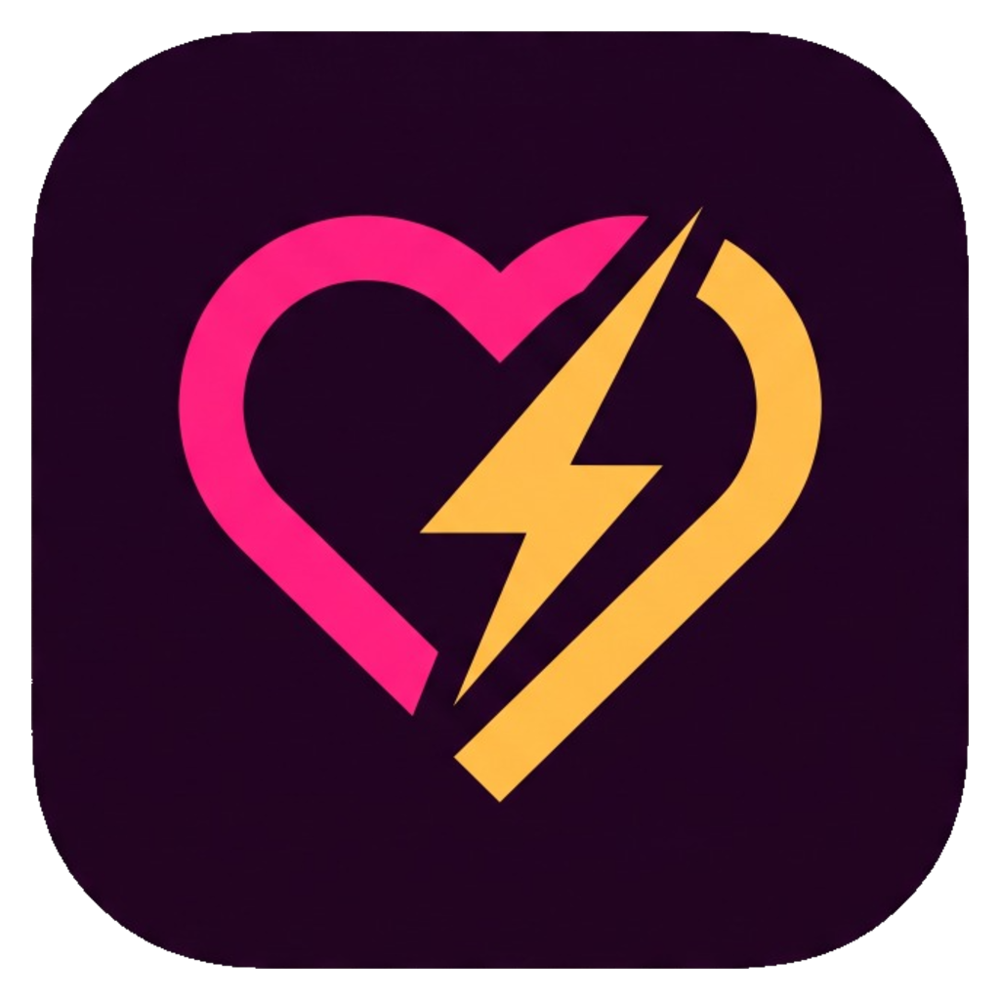
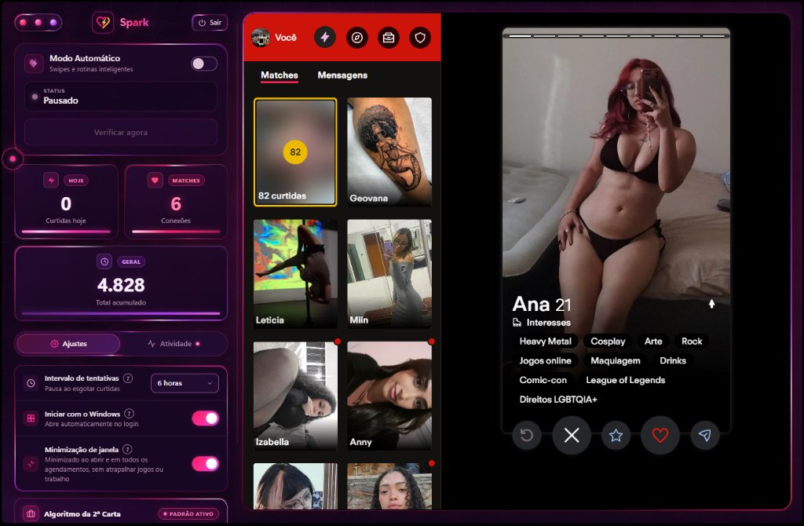

<div align="center">



# Spark

**Automação inteligente, nativa e ultraleve para o Tinder no Windows — mantém suas curtidas sempre em uso com visual Dark Neon e zero consumo em espera.**

[](https://github.com/mrodriguesh/Spark/releases/latest)
[-BC42FF?style=flat-square&logo=windows&logoColor=white)](https://github.com/mrodriguesh/Spark/releases/latest/download/Spark-Setup-2.0.0.exe)
[-0078D4?style=flat-square&logo=windows11&logoColor=white)](#requisitos)
[](#arquitetura)
[](LICENSE)

[**💡 A Ideia**](#ideia) · [**🖥️ A Interface**](#interface) · [**✨ Funcionalidades**](#funcionalidades) · [**🚀 Como Instalar**](#instalar) · [**🎯 Como Usar**](#como-usar) · [**🏗️ Arquitetura**](#arquitetura) · [**💻 Compilar do Código**](#desenvolvimento)

</div>

---

<div align="center">
  
  <br>
  <sub><b>Interface principal do Spark 2.0</b> — painel lateral <i>Neon Cabaré</i> com controle do Modo Automático, contadores em tempo real, ajustes de rotina, Algoritmo da 2ª Carta e navegador isolado do Tinder integrado à direita.</sub>
</div>

---

<a id="ideia"></a>
## 💡 A Ideia do Aplicativo

No Tinder gratuito, as curtidas são limitadas e levam horas para recarregar. Usar o aplicativo manualmente todos os dias exige tempo repetitivo, enquanto extensões improvisadas de navegador obrigam você a deixar o navegador aberto consumindo centenas de megabytes de memória, travam em avisos promocionais ou param de funcionar quando o computador entra em suspensão.

O **Spark** foi criado para resolver isso de forma definitiva como um **aplicativo desktop 100% nativo para Windows**, escrito do zero em **Rust** sobre o **Microsoft Edge WebView2** (instalador de apenas **~2,5 MB**, sem o peso do Electron):

1. 🎯 **Aproveitamento inteligente das curtidas (Algoritmo da 2ª Carta):** Sempre que o Tinder é aberto ou recarregado, perfis que já curtiram você costumam aparecer posicionados na **2ª carta** da pilha. Por padrão, o Spark pula a 1ª carta, curte a 2ª e recarrega — maximizando suas chances reais de *match* por curtida disponível.
2. 🔋 **Zero CPU e Zero RAM enquanto aguarda:** Assim que suas curtidas acabam, o Spark não fica aberto em segundo plano gastando recursos. Ele registra automaticamente o horário da próxima tentativa no **Agendador de Tarefas do Windows** e **fecha por completo (0% de CPU e 0 MB de RAM)**. Na hora agendada — ou assim que você ligar o PC novamente — ele reabre sozinho, faz um novo ciclo e volta a descansar.
3. 🎮 **Não interrompe jogos nem trabalho:** Com suporte à bandeja do sistema (*System Tray*) e ao modo de **Minimização de janela**, todas as verificações e reaberturas automáticas acontecem de forma silenciosa, sem jamais pular na frente da tela ou roubar o foco do teclado e do mouse.
4. 🔒 **100% Local e Privado:** Sua sessão do Tinder vive exclusivamente dentro de um perfil isolado do WebView2 no seu próprio computador (`%APPDATA%\Spark`). Nenhuma senha, cookie, localização ou métrica é enviada para servidores externos.

---

<a id="interface"></a>
## 🖥️ Conhecendo a Interface

A janela do Spark une o **painel de controle** à esquerda e o **Tinder real** à direita em uma única moldura fluida:

| Área da Interface | O que faz |
|---|---|
| 💎 **Barra Superior (`Spark` + Gemas + `Sair`)** | As três gemas néon controlam a janela (**Fechar** recolhe para a bandeja, **Minimizar** e **Maximizar/Restaurar**). O botão **Sair** encerra o aplicativo imediatamente. |
| ⚡ **Cartão Modo Automático** | Chave mestre para ativar ou pausar os swipes automáticos, indicador colorido de **Status** em tempo real (*Executando*, *Aguardando*, *Pausado*, *Login pendente*) com cronômetro regressivo e botão **Verificar agora** para iniciar uma rodada na hora. |
| 📊 **Painel Analítico (`Hoje` · `Matches` · `Geral`)** | Exibe as **Curtidas hoje** (zeradas automaticamente à meia-noite), o total de **Matches / Conexões** detectadas durante os ciclos e o **Total acumulado** histórico. |
| ⚙️ **Aba Ajustes** | Configure o **Intervalo de tentativas** após esgotar curtidas (`15 min`, `30 min`, `1 hora`, `2 horas` ou `6 horas`), **Iniciar com o Windows** e **Minimização de janela**, além do resumo visual do **Algoritmo da 2ª Carta**. |
| 📈 **Aba Atividade** | Histórico ao vivo com horário de cada evento (curtidas confirmadas, matches, pausas, agendamentos e retomadas) e o cartão de status do **Agendamento Inteligente (Zero CPU)**. |
| 🌐 **Palco do Tinder (Lado Direito)** | Navegador dedicado em `tinder.com` com sessão persistente: faça login uma vez, responda mensagens, veja seus *matches* e edite seu perfil sem sair do Spark. |

---

<a id="funcionalidades"></a>
## ✨ Funcionalidades e Destaques

- 🎨 **Design Dark *Neon Cabaré*:** Textura aveludada escura, feixes circulares animados em GPU nas bordas dos cartões, efeito *spotlight* (luz que acompanha o ponteiro do mouse) e cursor personalizado com ponto + anel de inércia.
- 💤 **Economia Automática de GPU:** Quando a janela está sem foco, minimizada ou recolhida na bandeja do Windows, todas as animações de interface são pausadas automaticamente.
- 🤖 **Motor de Swipes Humanizado e Resiliente:** Intervalos variáveis e naturais entre ações, fechamento automático de pop-ups e telas de *Match*, confirmação real de cada curtida antes de somar nas métricas e reconexão automática com *backoff* se a internet oscilar.
- 📍 **Geolocalização Integrada ao Windows:** Sincroniza a localização diretamente com o serviço nativo do Windows (mantida apenas em memória temporária, nunca salva em disco ou log) para evitar bloqueios de permissão no Tinder Web.
- 🛡️ **Armazenamento Atômico Anticoerção:** Configurações e contadores em `spark.json` são gravados com troca atômica e cópia de segurança automática (`.tmp` → `.bak` → principal), protegendo seus dados contra desligamentos abruptos.
- ♿ **Acessibilidade Nativa:** Navegação completa por teclado nas abas e seletores, respeito automático à preferência de movimento reduzido (`prefers-reduced-motion`) e suporte a temas de Alto Contraste do Windows.

---

<a id="instalar"></a>
## 🚀 Como Instalar

<a id="requisitos"></a>
### 💻 Requisitos

| Item | Especificação |
|---|---|
| 🪟 **Sistema Operacional** | **Windows 10** (64 bits) ou **Windows 11** |
| 🌐 **Runtime WebView2** | **Microsoft Edge WebView2 Runtime** *(já vem instalado por padrão no Windows 11 e na grande maioria dos PCs com Windows 10)* |
| 💾 **Espaço em Disco** | **~2,5 MB** para baixar · **~7 MB** instalado |
| 🔑 **Permissões** | Instalação por usuário — **não pede senha de Administrador** |

---

### 📦 Opção 1: Instalador do Windows (Recomendado · 1 Clique)

A forma mais simples e rápida para qualquer usuário:

1. Acesse a página de [**Releases**](https://github.com/mrodriguesh/Spark/releases/latest) ou clique diretamente aqui para baixar o instalador:
   👉 [**Baixar `Spark-Setup-2.0.0.exe`**](https://github.com/mrodriguesh/Spark/releases/latest/download/Spark-Setup-2.0.0.exe)
2. Abra o arquivo **`Spark-Setup-2.0.0.exe`** baixado.
3. Pronto! O instalador configura o Spark automaticamente em `%LOCALAPPDATA%\Programs\Spark`, cria os atalhos na **Área de Trabalho** e no **Menu Iniciar**, e abre o aplicativo em seguida.

> [!NOTE]
> **Aviso do Windows SmartScreen:** Como este é um projeto independente e gratuito sem certificado comercial pago de assinatura de código, o Windows pode exibir a janela *"O Windows protegeu o computador"* na primeira execução. Clique em **Mais informações** e depois em **Executar assim mesmo**. Você pode conferir o código-fonte completo neste repositório e validar o hash do arquivo pelo `SHA256SUMS.txt` disponível no Release.

---

### ⚡ Opção 2: Instalação via PowerShell (1 Comando)

Se preferir instalar ou atualizar direto pelo terminal (com verificação automática de integridade **SHA-256** e checagem do **WebView2**):

1. Abra o **PowerShell** do Windows.
2. Cole o comando abaixo e pressione **Enter**:

```powershell
irm https://github.com/mrodriguesh/Spark/releases/latest/download/install.ps1 | iex
```

---

### 🗑️ Como Desinstalar

Vá em **Configurações do Windows → Aplicativos → Aplicativos instalados**, procure por **Spark** e clique em **Desinstalar**.
Por segurança, seus dados locais e sessão em `%APPDATA%\Spark` não são apagados automaticamente na desinstalação (apague essa pasta manualmente caso deseje limpar tudo do zero).

---

<a id="como-usar"></a>
## 🎯 Como Usar

1. **Abra o Spark** pelo atalho na Área de Trabalho ou no Menu Iniciar.
2. **Entre na sua conta do Tinder** usando o navegador integrado no lado direito da janela (você só precisa fazer login na primeira vez).
3. Na aba **Ajustes** (painel esquerdo):
   - Escolha o **Intervalo de tentativas** desejado para quando as curtidas esgotarem (ex.: `1 hora`, `2 horas` ou `6 horas`).
   - Ative **Iniciar com o Windows** se quiser que o Spark trabalhe sempre de forma autônoma.
   - Ative **Minimização de janela** se quiser que ele permaneça sempre discreto na barra de tarefas durante jogos ou trabalho.
4. Ligue a chave **Modo Automático** no cartão superior. O Spark iniciará os ciclos imediatamente e cuidará dos agendamentos futuros sozinho!

> [!TIP]
> **Fechar vs. Sair:** Clicar no botão vermelho da janela recolhe o Spark para a **bandeja do sistema** (perto do relógio do Windows). Clicar em **Sair** encerra o aplicativo — mas se houver uma tentativa agendada pelo Modo Automático, o Windows continuará reabrindo o Spark no horário marcado. Para interromper qualquer agendamento futuro, basta desligar a chave **Modo Automático**.

---

<a id="arquitetura"></a>
## 🏗️ Arquitetura e Estrutura do Repositório

O Spark 2.0 separa a interface e integração Win32 (`host`) da máquina de estados assíncrona (`core`) e de bibliotecas puras determinísticas (`units`):

```text
Spark/
├── docs/
│   └── interface.jpg              # Captura de tela da interface principal
├── rust/
│   ├── app/                       # Aplicativo nativo Windows (Rust + tao + wry / WebView2)
│   │   ├── assets/                # Ícones oficiais (.png, .ico, .svg)
│   │   ├── src/
│   │   │   ├── host/              # Thread de UI: janela, bandeja, WebView2, CDP, registro e energia
│   │   │   └── core/              # Thread de lógica: motor de swipes, ciclos, geolocalização e agenda
│   │   ├── ui/index.html          # Interface Dark Neon Cabaré embutida no binário final
│   │   └── tests/                 # Testes automatizados de motor, traces e agendamento
│   ├── units/                     # Crates puras e testáveis da regra de negócio
│   │   ├── classify/              # Classificação de estado da tela do Tinder (card, match, popup, fim)
│   │   ├── main-pure/             # Validação de URLs permitidas e regras puras
│   │   ├── patterns/              # Padrões e expressões regulares de detecção
│   │   ├── scheduler/             # Geração e validação de tarefas no Agendador do Windows
│   │   └── store/                 # Persistência JSON atômica com recuperação (.tmp / .bak)
│   ├── installer/                 # Empacotador NSIS (build.sh, Instalar Spark.bat e install.ps1)
│   └── tests-js/                  # Suite de testes end-to-end de janela, cursor, hover e bandeja
├── LICENSE                        # Licença MIT
└── README.md                      # Documentação principal
```

---

<a id="desenvolvimento"></a>
## 💻 Compilar a partir do Código-Fonte

Caso prefira compilar o executável e gerar o seu próprio instalador localmente:

### Pré-requisitos de compilação
- [Rust Toolchain](https://rustup.rs/) (`cargo` + MSVC `x86_64-pc-windows-msvc`)
- [Node.js LTS](https://nodejs.org/) (usado apenas pelo `electron-builder` para empacotar o instalador NSIS, sem embutir Electron)
- [Git for Windows](https://git-scm.com/download/win) (inclui o Git Bash)

### Passo a passo

```bash
# 1. Clone o repositório
git clone https://github.com/mrodriguesh/Spark.git
cd Spark

# 2. Compile o binário nativo otimizado (gera rust/app/target/release/Spark.exe)
cd rust/app && cargo build --release && cd ../..

# 3. (Opcional) Gere o instalador completo em rust/dist/Spark Setup 2.0.0.exe
cd rust/installer && npm install && cd ../..
bash rust/installer/build.sh
```

> 💡 **Atalho no Windows:** Você também pode dar dois cliques diretamente em `rust\installer\Instalar Spark.bat` — se o instalador ainda não existir na pasta `rust\dist`, o script instala as ferramentas de empacotamento, compila o projeto em Rust e abre o instalador automaticamente.

### Rodar os testes

```bash
# Testes unitários e de integração das crates Rust
cd rust/app && cargo test --release
```

---

## 📄 Licença e Aviso Legal

Distribuído sob a licença **MIT** — veja o arquivo [LICENSE](LICENSE) para mais detalhes. Sinta-se livre para baixar, usar, estudar e contribuir.

*Aviso: O Spark é um projeto independente de código aberto e não possui qualquer afiliação, patrocínio ou endosso do Tinder ou do Match Group, Inc. Utilize por sua própria conta e responsabilidade.*
